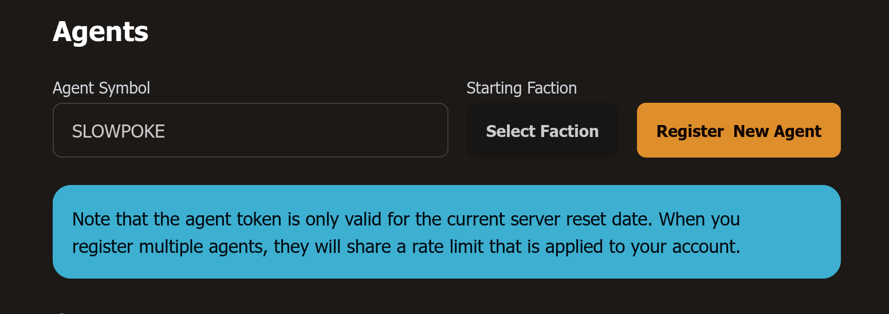
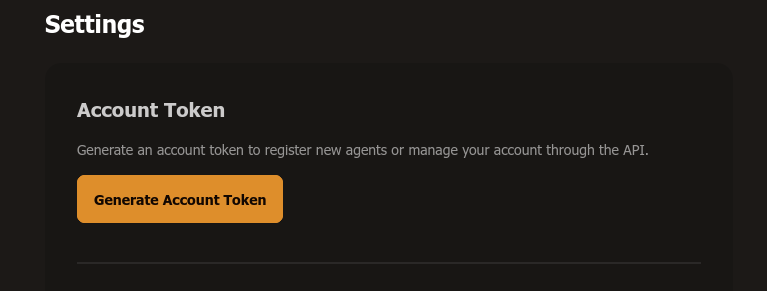

<!-- Mirrored from https://docs.spacetraders.io/quickstart/new-game -->

# New Game

The quickstart guide should take about 5 minutes and will walk a new user through some common HTTP requests when working with the SpaceTraders API.

Each request can be sent from the browser or pasted into your terminal using cURL. The parameters of each request should update automatically as you complete each step.

## Starting a new game

To start a new game, you will need to create an account and generate an agent token. Agent tokens are used to authenticate (almost all) requests to the API, and are required to play the game.

## Create an account

To register an account, you should log in to the spacetraders dashboard at [https://my.spacetraders.io](https://my.spacetraders.io). After you sign up, you'll be able to go to the 'agents' page and register a new agent, or use a generated *account* token to register an agent programmatically.

## Agents

Players are called agents, and each agent is identified by a unique call sign, such as `ZER0_SH0T` or `SP4CE_TR4DER`. All of your ships, contracts, credits, and other game assets will be associated with your agent identity.

## Register as a new agent



Your starting faction will determine which system you start in, but any faction should be fine for now.

After you've registered an agent, you should be able to press the "Generate Token" button in the list to get an agent token for that agent. Don't worry about losing it, you can generate a new one at any time.

### Alternative: Register by API

If you want to register by API, you will first need to obtain your account token from the dashboard.

Click the "Settings" menu in the sidebar, then click the "Generate Account Token" button.



You can then use the following request:

```bash
curl -X POST 'https://api.spacetraders.io/v2/register' \
  -H 'Authorization: Bearer $ACCOUNT_TOKEN' \
  -H 'Content-Type: application/json' \
  -d '{"symbol":":callSign","faction":":factionSymbol"}'
```

The response should include your access token, which will be used to authenticate all future requests.

> **Note: Agent Token**
>
> If you've used these docs to make the request, the agent token should have already been saved and will automatically be used for future requests.

## Data for your agent

You can see the data for your agent along with your starting faction, ships, and faction contract at any time by calling the `my/agent` endpoint.

```bash
curl -X GET 'https://api.spacetraders.io/v2/my/agent' \
  -H 'Authorization: Bearer $AGENT_TOKEN'
```

## View your starting location

Your command ship is located at your faction's headquarters. Each location in SpaceTraders is referred to as a waypoint. Ships can navigate between different waypoints in a system and even jump across systems in the universe.

The universe is made up of many systems, each with a set of waypoints. Every waypoint has a symbol such as `X1-DF55-A1` made up of the sector, system, and location of the waypoint. For example, `X1` is the sector, `X1-DF55` is the system, and `X1-DF55-A1` is the waypoint.

To view your starting waypoint location, send the following request:

```bash
curl -X GET 'https://api.spacetraders.io/v2/systems/:systemSymbol/waypoints/:waypointSymbol'
```

> **Note: Dynamic Request Values**
>
> Dynamic values in the documentation should autofill with values from other requests as you complete them, but you can also manually edit the values.
>
> For example, you can edit the `:systemSymbol` and `:waypointSymbol` variables in the above request.

Each waypoint has a type (planet, moon, orbital station), a set of coordinates, and some traits describing the features of the location. For example, a waypoint may have a marketplace for trading goods, or a shipyard for buying and selling ships.

## Coordinates

A quick note about coordinates: each waypoint has a set of x, y coordinates that describe its location relative to the system it is in. System coordinates are absolute units at the galactic scale.

When visualizing the universe, you can use the system coordinates to determine the position of each system, and then use the waypoint coordinates to determine the relative position of each waypoint within that system (the center of the system is 0,0).
